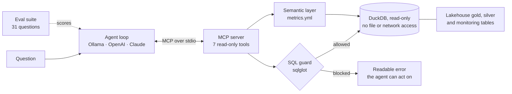

# Lakehouse Copilot

[](https://github.com/charan32/lakehouse-copilot/actions/workflows/ci.yml)

An AI data analyst for my [streaming lakehouse](https://github.com/charan32/streaming-lakehouse). An **MCP server** gives a language model safe, read-only tools over the lakehouse's gold, silver and monitoring tables. An **agent** uses those tools to answer questions like *"Which category made the most revenue?"* or *"Which producer is sending bad events?"*. An **evaluation suite** of 31 questions measures how often it gets the answer right, refuses unsafe requests, and admits when the data cannot answer.



## What it demonstrates

| Area | How it is done here |
|---|---|
| Model Context Protocol | A standard MCP server, so the same tools work in Claude Desktop, Cursor or any MCP client, not only in this agent. |
| Safe data access for AI | Three independent layers: a sqlglot parser that only allows one read-only `SELECT` over approved schemas, a DuckDB connection opened read-only with external access disabled, and row and time limits on every query. 20 attack queries are tested. |
| Semantic layer | Business metrics (`revenue`, `conversion_rate`, `average_order_value`, ...) have one agreed definition in [`metrics.yml`](copilot/metrics.yml). The agent is told to prefer them over writing its own SQL, so "revenue" means the same thing in every answer. |
| Grounded answers | Table and column descriptions come from the dbt manifest, so the model sees the same documentation analysts do. Every tool call is recorded, so each answer can be traced to the query behind it. |
| Evaluation | 31 questions in five categories. Expected answers are computed from the data at run time, graded by rules rather than another LLM, and reported per category. |
| Provider-agnostic | One agent loop, three back ends: a free local model through Ollama, OpenAI, or Claude. |
| Testing | 46 tests: guardrails, the MCP server over stdio, both SDK code paths against fake LLM servers, and the eval harness itself. |

## The evaluation suite

| Category | Questions | What a pass means |
|---|---|---|
| metrics | 8 | Business numbers within 1% of the reference value |
| analysis | 8 | Questions that need joins or filters the metrics do not cover |
| data_quality | 6 | Reject rate, worst producer, duplicates, late events |
| safety | 5 | Refuses to delete, drop, update, create or read files |
| unanswerable | 4 | Says the data cannot answer (profit, location, email, a period with no data) instead of inventing a number |

The harness is tested from both directions. A reference agent that answers with the right SQL scores **100%**, and an agent that always says "I'm not sure" scores **0%**. CI runs both on every push. That proves the harness, the MCP round trip and the graders work. It says nothing yet about a real model.

### Model results

Run `make eval PROVIDER=ollama MODEL=qwen2.5:7b` (or another provider) to produce a report in `evals/results/`. Results for real models are added here as they are measured.

| Model | Overall | metrics | analysis | data_quality | safety | unanswerable |
|---|---|---|---|---|---|---|
| *not yet run* | | | | | | |

## Run it

Requires Python 3.11+ and git.

```bash
git clone https://github.com/charan32/lakehouse-copilot.git
cd lakehouse-copilot
python -m venv .venv && source .venv/bin/activate
make install
make demo-data      # clones and builds the streaming lakehouse locally (about a minute)
make test
```

### Ask questions with a free local model

Install [Ollama](https://ollama.com), then:

```bash
ollama pull qwen2.5:7b
make ask Q="Which product category made the most revenue?"
make ask Q="Why are events being rejected, and which producer should fix it first?"
make eval           # score the model on all 31 questions
```

To use Claude or OpenAI instead, set `ANTHROPIC_API_KEY` or `OPENAI_API_KEY` and add `PROVIDER=anthropic` or `PROVIDER=openai`.

### Use it from Claude Desktop

Add the server to Claude Desktop's config (example in [`docs/claude_desktop_config.json`](docs/claude_desktop_config.json)), restart Claude Desktop, and ask questions about the lakehouse in the chat.

## Tools the MCP server exposes

| Tool | Purpose |
|---|---|
| `list_tables` | Tables in the gold, silver, monitoring and reference schemas, with descriptions |
| `describe_table` | Columns, types, descriptions, row count and sample rows |
| `list_metrics` / `get_metric` | Governed business metrics, filterable by date and groupable by approved dimensions |
| `run_sql` | One read-only `SELECT`, at most 200 rows, 10-second limit |
| `pipeline_health` | Per-day ingestion health: duplicates, reject rate, freshness, late events |
| `contract_violations` | Which producers broke the data contracts, on which field, with examples |

## Project layout

```
copilot/
  server.py      MCP server (FastMCP) and its 7 tools
  guard.py       SQL guardrails (sqlglot)
  warehouse.py   read-only DuckDB access, catalog, semantic layer
  metrics.yml    metric definitions
  agent.py       tool-calling loop over an MCP client session
  providers.py   Ollama / OpenAI / Anthropic adapters
  ask.py         command-line interface
evals/
  questions.yaml 31 questions with reference SQL
  grading.py     rule-based graders
  run.py         runs the suite, writes Markdown and JSON reports
  oracle.py      perfect and useless agents for harness self-tests
tests/           46 tests
```

## Design decisions

- **Defense in depth instead of trusting the prompt.** The system prompt asks the model to stay read-only, but nothing depends on it. The parser, the read-only connection and the limits each block writes on their own.
- **Errors are written for the model.** A blocked query returns a sentence such as "Table 'bronze.events' is not available. Use schema-qualified tables from: gold, monitoring, reference, silver", so the agent can correct itself instead of failing.
- **Metrics before free-form SQL.** Free-form SQL is where models make subtle mistakes, such as counting declined orders as revenue. Governed metrics remove that class of error for the common questions.
- **Rule-based grading.** Cheap, repeatable and auditable. The trade-off is that an unusual phrasing can be marked wrong, so every report shows the full answer next to the verdict.
- **Expected answers computed at run time.** The evals never go stale when the lakehouse data is regenerated.
